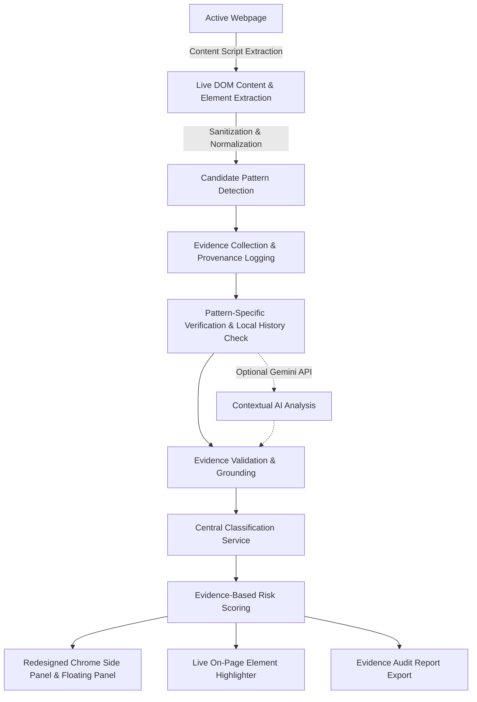

# ClearChoice AI — AI-Powered Dark Pattern Detection Extension

> **Real-time deceptive design pattern detection, evidence verification, and consumer protection for modern web browsers.**

[](#testing--quality-assurance)
[](#chrome-extension-setup)
[](#model-evaluation-benchmark)
[](#license)

---

## 1. Introduction & Design Philosophy

Modern commercial websites increasingly deploy deceptive interface patterns—commonly called **dark patterns**—to manipulate consumers into unintentional purchases, forced subscriptions, hidden fees, or unwarranted data disclosures.

### Core Philosophy
Every detection result in ClearChoice AI is **strictly traceable to actual observations**, and the strength of the conclusion never exceeds the strength of the available evidence.

- **Observed Behaviour vs Suspected Manipulation vs Verified Deception:** A website is never accused of being deceptive simply because it has a countdown timer, displays a discount, requires an account, or has a multi-step cancellation flow. These can be genuine commercial practices.
- **Evidence-Driven Standards:** Findings are classified across four centralized standards based on grounded observations, observable mathematics, and verified historical behavior.

---

## 2. Core Detection Pipeline

ClearChoice AI operates directly on **any arbitrary live website** visited in Google Chrome via an isolated Manifest V3 architecture.



---

## 3. Four Central Classifications

ClearChoice AI employs one shared central classification policy ([src/analysis/classification-service.ts](file:///Users/sreejareddy/Desktop/ACD_CBD/src/analysis/classification-service.ts)) across the extension and backend:

| Classification | Meaning & Standard | Qualifying Examples |
| :--- | :--- | :--- |
| **Verified Deceptive Behaviour** | Conclusive, reliable evidence directly confirms deceptive design or contradictory terms. | Stated discount % mathematically contradicts prices on the same item; crossed-out reference price $\le$ sale price; online signup with offline-only (phone/mail) cancellation. |
| **Strong Evidence of Dark Pattern** | Multiple observations strongly support manipulative design, with minor uncertainty remaining. | Countdown timer directly observed resetting to 05:00 upon reload; website advertised guest checkout but mandated password creation at final step. |
| **Potential Dark Pattern** | Suspicious wording or design observed, but independent merchant confirmation is unavailable. | Single countdown timer without verifiable deadline; "Only 2 left" without private warehouse inventory access; unverified MSRP claim. |
| **Insufficient Evidence** | Available information is incomplete, ambiguous, or directly points to legitimate operation. | Legitimate scheduled conference dates; disclosed shipping charges/taxes; standard login on account portal. |

---

## 4. The Six Primary Detectors & Verification Methodology

ClearChoice AI implements dedicated verification logic for the 6 primary categories rather than generic keyword scoring:

### 4.1 Detector 1: Fake Urgency (`urgency`)
- **Initial Candidate Detection:** Countdown timers, visible deadlines, urgency banners ("Offer expires soon").
- **Behavioral & Historical Verification:** Tracks timer samples over time. Uses [src/services/evidence-history.ts](file:///Users/sreejareddy/Desktop/ACD_CBD/src/services/evidence-history.ts) to record previous timer values and detect if the timer jumped upward or reset after expiration across visits.
- **False-Positive Resistance:** Legitimate conference dates, scheduled webinars, and fixed event notices are excluded from urgency flags.
- **Limitations:** A single countdown observation cannot verify merchant promotion policy without repeated observations.

### 4.2 Detector 2: Fake Scarcity (`scarcity`)
- **Initial Candidate Detection:** Inventory claims ("Only 2 left!"), room/seat availability notices, real-time viewer counters.
- **Historical Observation:** Stores observed claims per origin/URL. Records repeated claims observed across multiple visits.
- **Grounding Standards:** Always reports mandatory limitation that merchant live backend warehouse inventory is private and cannot be verified client-side. Does not label viewer counters fake without supporting evidence.

### 4.3 Detector 3: Misleading Discounts (`discounts`)
- **Initial Candidate Detection:** Stated sale prices, crossed-out reference prices, advertised discount percentages.
- **Mathematical Verification:** Calculates $\text{Discount} = \frac{\text{Original} - \text{Sale}}{\text{Original}} \times 100$. If advertised percentage exaggerates calculated math (e.g. claimed 60%, calculated 20%), classified as **Verified Deceptive Behaviour**.
- **Inverted Reference Prices:** Crossed-out price $\le$ current price is flagged as **Verified Deceptive Behaviour**.
- **False-Positive Resistance:** Mathematically correct discounts (e.g. $100 $\rightarrow$ $70, 30% off) evaluate cleanly without flags.

### 4.4 Detector 4: Hidden Charges & Drip Pricing (`hidden_charges`)
- **Initial Candidate Detection:** Checkout fee breakdowns, service surcharges, handling fees.
- **Verification Logic:** Compares itemized line items against initial advertised prices. Distinguishes disclosed taxes and shipping from undisclosed mandatory checkout fees.

### 4.5 Detector 5: Forced Sign-Up (`forced_signup`)
- **Initial Candidate Detection:** Registration walls, account creation prompts, guest checkout buttons.
- **Verification Logic:** Detects broken guest checkout promises (where the site offered "Continue as Guest" but subsequently mandated password creation). Distinguishes legitimate account requirements for secure account portals.

### 4.6 Detector 6: Difficult Cancellation — Roach Motel (`cancellation`)
- **Initial Candidate Detection:** Cancellation links, subscription management menus, confirmation dialogs.
- **Verification Logic:** Flags offline-only cancellation barriers (mandating phone calls or postal letters to cancel an online subscription) as **Verified Deceptive Behaviour**. Detects double-negative retention buttons ("Don't cancel, keep paying").

---

## 5. Google Gemini AI Contextual Integration

Google Gemini (`gemini-1.5-flash`) provides semantic context and consumer impact analysis:
- **Backend Architecture:** Kept strictly on the Node.js Express backend ([backend/src/server.ts](file:///Users/sreejareddy/Desktop/ACD_CBD/backend/src/server.ts)). The API key is never exposed to content scripts or extension bundles.
- **Prompt Injection Defense:** Webpage excerpts are enclosed in `<webpage_content>` and treated as untrusted data.
- **Structured JSON Output:** Requires structured JSON with `observations`, `classification_recommendation`, `supporting_evidence`, `contradictory_evidence`, and `missing_evidence`.
- **Unknown Evidence ID Rejection:** In [src/analysis/evidence-validator.ts](file:///Users/sreejareddy/Desktop/ACD_CBD/src/analysis/evidence-validator.ts), any AI finding that references an invented or unknown evidence ID is rejected or flagged for review.
- **Deterministic Fallback:** If the backend or AI is offline, the extension seamlessly continues running on local deterministic rules.

---

## 6. Evidence-Based Risk Scoring

The risk score ($0–100$) represents the weight and strength of verified findings rather than raw keyword hits:

$$\text{Contribution} = \text{BaseWeight} \times \frac{\text{Confidence}}{100}$$

- **Base Severity Weights:** Informational: 5, Low: 10, Medium: 20, High: 30, Critical: 40.
- **Evidence Zeroing:** Findings with `insufficient_evidence` or `contradicted` status contribute **0 points** (preventing artificial score inflation).
- **Element Deduplication:** Multiple rules matching the same DOM element are deduplicated.
- **Diminishing Returns:** Sorted contributions decay across findings ($1.0, 0.75, 0.55, 0.35, 0.20$).
- **Score Thresholds:**
  - **0–19:** `LOW RISK` (Clean pages evaluate to 0/100)
  - **20–39:** `MODERATE RISK`
  - **40–69:** `HIGH RISK`
  - **70–100:** `VERY HIGH RISK`

---

## 7. Chrome Side Panel & Floating UI Design

The user interface follows a modern, trustworthy security dashboard design:
- **Design System:** Deep navy (`#10172A`), dark surface (`#172036`), primary violet (`#6C5CE7`), secondary cyan (`#22D3EE`), light background (`#F5F7FC`), and accessible status colors (`#16A34A`, `#D97706`, `#DC2626`).
- **Summary Card:** Shows origin, last scan time, overall risk level, risk score, candidate count, verified findings, and awaiting verification count.
- **Finding Cards:** Features distinct visual badges for all 4 classifications, expandable evidence records with DOM selectors, transparent limitations, and consumer recommendations.
- **Element Highlighter:** Smoothly scrolls to the element on the live webpage, applies an outline (`3px solid #ea580c`), and creates a dismissible annotation badge.
- **Evidence Report Export:** Exports audit reports as JSON, formatted `.txt` files, or copies directly to clipboard with legal disclaimers.

---

## 8. Chrome Extension Setup (Load Unpacked)

1. Open **Google Chrome** and navigate to:
   ```
   chrome://extensions/
   ```
2. Enable **Developer mode** using the toggle switch in the top-right corner.
3. Click the **Load unpacked** button.
4. Select the [`dist`](file:///Users/sreejareddy/Desktop/ACD_CBD/dist) directory inside this repository:
   ```
   /Users/sreejareddy/Desktop/ACD_CBD/dist
   ```
5. Pin **ClearChoice AI** to your Chrome toolbar.
6. Open any webpage. The floating ClearChoice AI panel will appear in the top-right corner. You can also open the Chrome Side Panel or press `Alt+Shift+D`.

---

## 9. Testing & Quality Assurance

The repository includes a comprehensive unit, integration, benchmark, and real-website DOM test suite executed via Vitest:

```bash
npm test
```

### Current Test Suite Status
- **Total Test Files:** 10 passed (100%)
- **Total Tests:** 49 passed (100%)
  - `tests/unit/detectors-and-classifications.test.ts` (14 tests)
  - `tests/unit/scoring.test.ts` (5 tests)
  - `tests/unit/normalizer.test.ts` (6 tests)
  - `tests/unit/evidence-validator.test.ts` (3 tests)
  - `tests/unit/rules.test.ts` (9 tests)
  - `tests/integration/real-website-scans.test.ts` (4 tests)
  - `tests/integration/analyzer-pipeline.test.ts` (2 tests)
  - `tests/integration/backend.test.ts` (2 tests)
  - `tests/integration/storage-report.test.ts` (3 tests)
  - `tests/evaluation/benchmark.test.ts` (1 test)

### Production Build Commands
```bash
# Build Chrome Extension to dist/
npm run build

# Build Interactive Demo Testbed to dist-demo/
npm run build:demo

# Run Demo Testbed Locally
npm run demo
```

---

## 10. Privacy & Security Safeguards

- **Privacy Normalizer ([src/analysis/normalizer.ts](file:///Users/sreejareddy/Desktop/ACD_CBD/src/analysis/normalizer.ts)):** Passwords, credit card numbers, CVVs, OTPs, session cookies, and authentication tokens are never extracted, stored, or transmitted.
- **Isolated Shadow DOM:** Prevents host website scripts from inspecting or interfering with ClearChoice UI state.
- **Origin-Scoped History:** Evidence history is strictly partitioned by origin/URL to eliminate cross-site tracking.
- **Prompt Injection Defense:** Untrusted webpage text cannot alter instructions or model role.
- **Disclaimer:** Automated assessments represent observable client-side elements and do not constitute formal judicial certification or legal advice.

---

## 🌐 Scanning Real Websites with the Chrome Extension

1. **Build the extension**:
   ```bash
   npm run build
   ```
2. **Load into Google Chrome**:
   * Navigate to `chrome://extensions`
   * Enable **Developer mode** (top-right toggle)
   * Click **Load unpacked** and select:
     ```text
     /Users/sreejareddy/Desktop/ACD_CBD/dist
     ```
   * *If already loaded:* Click the **Reload** (circular arrow) icon on the ClearChoice AI card in `chrome://extensions`.
3. **Open Any Web Page**:
   * Visit any live e-commerce, shopping, subscription, or media site (e.g., Amazon, Walmart, BestBuy, travel booking sites, news outlets).
   * Note: Chrome security policies prohibit content scripts from executing on browser-internal pages (`chrome://*`, `about:blank`) and the Chrome Web Store.
4. **Trigger a Scan**:
   * Click the **ClearChoice AI** toolbar icon to open the popup.
   * Click **Scan This Page**.
   * ClearChoice AI extracts live DOM text, prices, timers, modals, and buttons, performs local deterministic verification, consults the local Gemini AI backend at `http://localhost:3001` when active, computes an evidence-grounded risk score, and displays findings with expandable evidence records.
   * Click **Highlight on Page** on any finding to outline the exact suspicious element on the live website.

